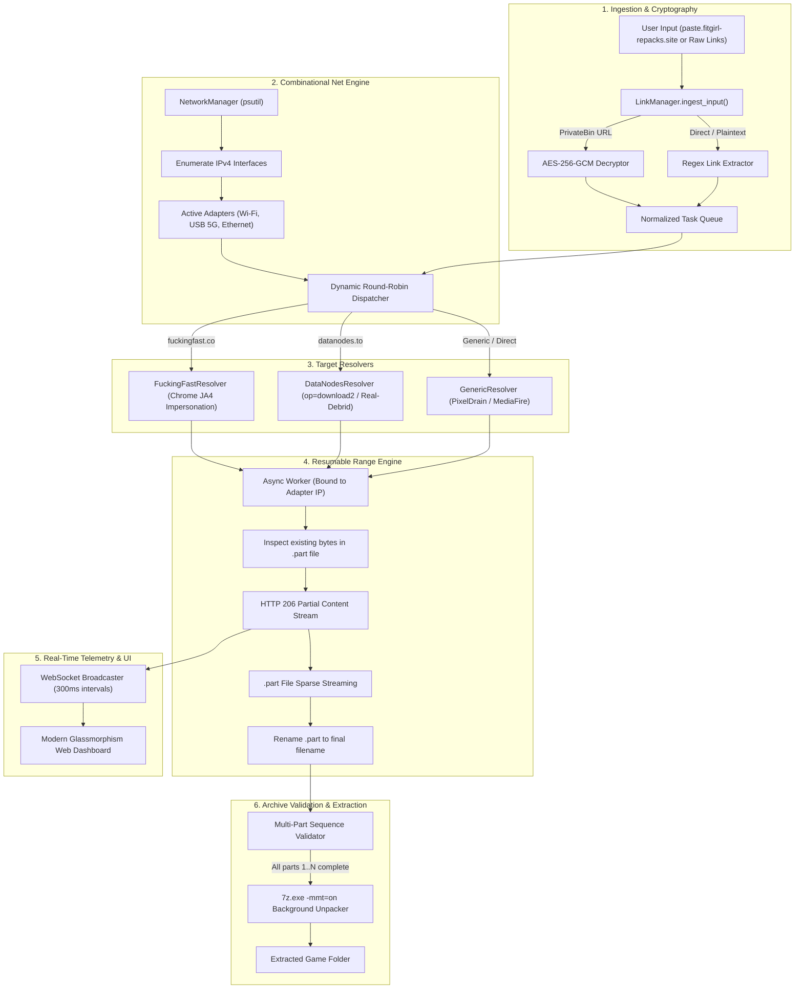
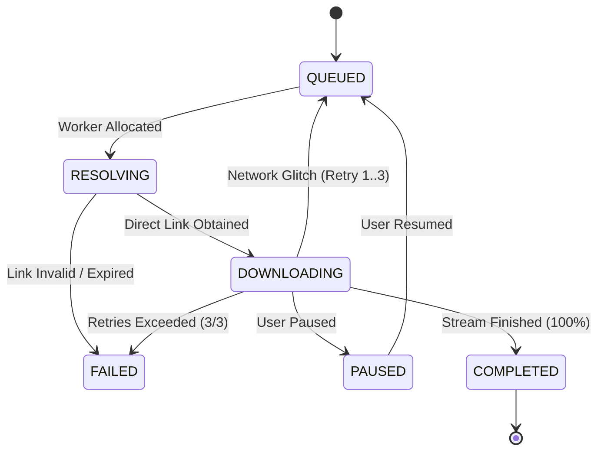

# 📐 PartHarvester Technical Architecture Specification

## 1. Overview
PartHarvester is architected as an asynchronous, non-blocking pipeline combining:
1. Client-side cryptographic decryption for zero-knowledge encrypted pastebins.
2. Low-level socket interface binding (`CURLOPT_INTERFACE`) for multi-WAN channel bonding.
3. TLS JA3/JA4 fingerprint impersonation via `curl_cffi` to pass Cloudflare checks.
4. Resumable HTTP Range chunking with state persistence.
5. Automated sequence validation and multithreaded extraction via 7-Zip.



---

## 2. Cryptographic Specification: PrivateBin v2 Decryption

FitGirl pastes are served by an official PrivateBin instance:
`https://paste.fitgirl-repacks.site/?<paste_id>#<key>`

### 2.1 Decryption Steps
1. **Payload Request**: Fetch `https://paste.fitgirl-repacks.site/?<paste_id>` with header:
   ```http
   X-Requested-With: JSONHttpRequest
   ```
2. **Key Derivation**: The fragment `#<key>` is decoded using **Base58** into a 32-byte (256-bit) raw symmetric AES key:
   $$K_{\text{AES}} = \text{Base58Decode}(\text{fragment\_key})$$
3. **Parameter Extraction**: From the JSON response:
   - `adata`: Array containing `[iv_b64, salt_b64, iterations, keysize, tagsize, algorithm, mode, compression]`
   - `ct`: Base64 string containing raw ciphertext concatenated with the 128-bit authentication tag.
4. **Additional Authenticated Data (AAD)**:
   AAD integrity verification requires exact compact JSON encoding of the `adata` structure without spaces:
   $$\text{AAD} = \text{compact\_json}(\text{adata})$$
5. **Decryption**:
   $$\text{Plaintext}_{\text{compressed}} = \text{AES-GCM-256}_{K_{\text{AES}}}(\text{IV}, \text{Ciphertext}, \text{AAD}, \text{Tag})$$
6. **Decompression**:
   The decrypted byte stream is decompressed via standard `zlib.decompress()`, yielding the underlying JSON object containing the plaintext download links.

---

## 3. Combinational Net: Socket Interface Binding on Windows

### 3.1 The Single-Gateway Problem
By default, Windows uses Route Metric prioritization. Outgoing sockets bind to `0.0.0.0` and are dispatched through only one default gateway (usually Ethernet), leaving secondary interfaces (like USB 5G Tethering or Wi-Fi) completely unused.

### 3.2 PartHarvester's Solution
PartHarvester bypasses default gateway routing by explicitly binding client sockets to specific local IPv4 addresses assigned to each network adapter:
```python
session = requests.AsyncSession(
    impersonate="chrome",
    interface=adapter.ip_address  # Binds CURLOPT_INTERFACE
)
```
- Each download task is assigned to an enabled adapter in the pool.
- **Dynamic Load Balancing**: Slower connections (e.g. 5 MB/s Wi-Fi) download fewer parts; faster connections (e.g. 20 MB/s 5G USB) pull more parts from the queue.
- **Session Safety**: Each file part is resolved and downloaded on the *same* network interface, preventing CDN token IP-mismatch errors (`403 Forbidden`).

### 3.3 TurboBond: Intelligent Scheduling & Work-Stealing Engine

#### 1. EWMA Bandwidth Tracking
Each interface's throughput is continuously updated using an Exponentially Weighted Moving Average with factor $\alpha = 0.35$:
$$\text{EWMA}_{t} = \alpha \cdot \text{Speed}_{\text{instant}} + (1 - \alpha) \cdot \text{EWMA}_{t-1}$$

#### 2. Proportional Adaptive Quotas & Anti-429 Clamping
Instead of naive round-robin, concurrency slots are dynamically allocated proportionally to measured EWMA speeds, clamped by a per-interface connection cap (e.g., maximum 3 streams per unique public IP):
$$\text{Quota}_i = \text{clamp}\left(1, \, \text{Cap}_i, \, \text{round}\left(S_{\text{total}} \cdot \frac{\text{EWMA}_i}{\sum_j \text{EWMA}_j}\right)\right)$$
Because each adapter routes through a separate public IP (e.g. home broadband vs. cellular 5G), hoster rate-limit counters are completely isolated, enabling safe multi-fold speed multipliers.

#### 3. Autonomous Straggler Work-Stealing (Hand-Off)
When high-speed connections finish their queue, an autonomous watchdog detects when a fast adapter has idle capacity while a slow adapter is still grinding through a large file part ($>50\text{ MB}$ remaining and $\text{Speed}_{\text{fast}} \ge 2.0 \times \text{Speed}_{\text{slow}}$). The watchdog:
1. Checkpoints and closes the existing stream on the slow adapter.
2. Hands off the task to the fast adapter.
3. Resumes the remaining bytes immediately using HTTP Range headers on the high-speed interface.

#### 4. Pipelined Background Pre-Resolving
To eliminate latency between sequential parts, an asynchronous lookahead worker pre-resolves upcoming download tokens and direct URLs 5 tasks ahead in the background. When an active slot frees up, the download stream starts with zero DNS/HTMX round-trip latency.

---

## 4. Range Resuming Protocol & Lifecycle

Downloads transition through the following state machine:



### 4.1 `.part` File Resumption Mechanics
1. Target filename: `<dest_dir>/<filename>.part`.
2. Inspect `os.path.getsize(part_filepath)`:
   - If `existing_bytes > 0`, send header: `Range: bytes={existing_bytes}-`
3. Response Handling:
   - **HTTP 206 Partial Content**: Append to `.part` file in `'ab'` mode. Update `downloaded_bytes = existing_bytes`.
   - **HTTP 200 OK**: Server does not support Range requests; truncate and restart from offset 0 in `'wb'` mode.
   - **HTTP 416 Range Not Satisfiable**: File is already 100% downloaded on disk; finalize and mark `COMPLETED`.
4. Upon stream completion: Rename `<filename>.part` to final `<filename>`.

---

## 5. Multi-Part Archive Detection & Extraction

The `ArchiveExtractor` monitors completed tasks using regular expressions:
- `^(?P<prefix>.+?)[_\.-]part(?P<idx>\d+)\.(?P<ext>rar|exe)$`
- `^(?P<prefix>.+?)\.part(?P<idx>\d+)\.(?P<ext>rar)$`
- `^(?P<prefix>.+?)\.(?:7z|rar)\.(?P<idx>\d{3})$`

### Sequence Verification
For a detected prefix (e.g. `Phantom_Blade_Zero_-_fitgirl-repacks.site_-_part`):
1. Collect all detected indices: $\{1, 2, \dots, N\}$.
2. Completeness condition:
   $$\text{len}(\text{indices}) == N \quad \land \quad \min(\text{indices}) \in \{0, 1\} \quad \land \quad \forall i \in \text{indices}: \text{task}[i].\text{status} == \text{COMPLETED}$$
3. When condition is met and `auto_extract` is enabled:
   Executes background subprocess:
   ```cmd
   7z.exe x -y -mmt=on -o"<destination_dir>\<prefix>" "<destination_dir>\<first_part.rar>"
   ```

